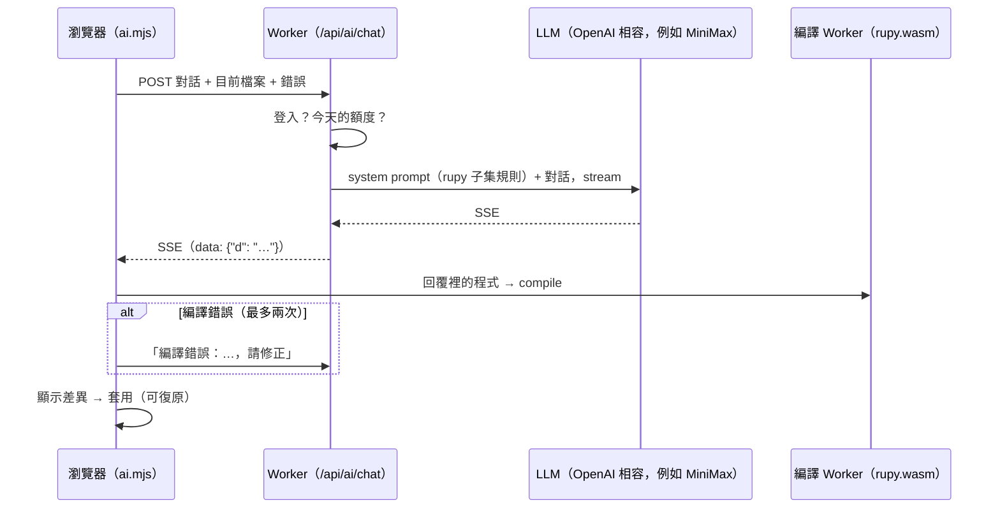

# rupy IDE：AI 助手（M6）

狀態：已完成（2026-11-11）。即時協作從 M6 移到 M7，有具體的使用情境再做。

## 目標

rupy 只支援 Python 的一個子集，一般寫法常被拒絕；wasm 後端又少了 generator、`heapq` 等。AI 助手要解決的就是這件事：

1. **修正錯誤**：編譯或執行出錯時，按「AI 修正」，AI 解釋原因，並改寫成 rupy 能編譯的程式。
2. **改寫成 rupy**：把一般 Python（Colab、Jupyter 匯入的程式）改成 rupy 支援的寫法。
3. **問答與產生**：問 rupy、rstatistics、numpy 怎麼用，或請它寫範例。

和一般聊天不同的地方：AI 給的程式會先在瀏覽器裡**編譯驗證**；編不過就把錯誤自動交回給 AI 再改（最多兩次），通過才標成「✓ 編譯通過」。套用前先看差異，套用後可以用 Ctrl/⌘ + Z 復原。

## 架構



* **伺服器（`src/worker.js`）**：`POST /api/ai/chat` 只給登入的使用者，代轉 OpenAI 相容的串流 API。金鑰只在伺服器（`.dev.vars` 的 `AI_API_KEY`），不會送到瀏覽器。
  * 設定：`AI_BASE_URL`（例如 `https://api.minimaxi.com/v1`）、`AI_MODEL`、`AI_API_KEY`；沒有設定 `AI_BASE_URL` 但有 Workers AI 綁定（`env.AI`）時改用 `env.AI.run`。兩者都沒有就不提供 AI，`/api/me` 回報 `ai: false`。
  * 額度：D1 的 `ai_usage(user_id, day, requests)`，每人每天 `AI_DAILY_LIMIT` 次（預設 100）。請求上限 128 KB；最多保留最近 20 則對話。
  * system prompt 寫 rupy 子集的規則、wasm 後端的限制、可用的套件，並要求回覆時把**完整**的檔案（或筆記本的那一格）放在一個 ```python 區塊裡。
* **前端（`public/ai.mjs`）**：工具列「AI」按鈕打開右側面板。
  * 送出時帶上目前檔案的內容，以及最近一次的編譯或執行錯誤。筆記本帶的是目前這一格與它上面的格子，套用時只換掉這一格。
  * 回覆用 Markdown 顯示（marked + DOMPurify，同文字格）；模型的 `<think>…</think>` 收在可展開的「思考過程」。
  * 回覆裡的 python 區塊用背景的編譯 Worker 驗證；有錯就自動追問，最多兩次。
  * 「看差異並套用」用 Monaco 的 diff editor；套用用 `executeEdits`，可以復原。
  * 錯誤出現時，輸出面板與狀態列旁出現「AI 修正」。
* **對話**只存在分頁記憶體裡（每個檔案一段），不存伺服器。

## 安全

* 金鑰只在伺服器；額度依帳號計算。未登入不能用。
* AI 的回覆用 DOMPurify 清過才顯示；程式只有在使用者按「套用」後才寫進檔案，而且程式本來就只在瀏覽器的 Worker 裡執行。
* 送給 LLM 的只有使用者自己的檔案內容與對話。

## 驗證

* `test/ai.test.mjs`：用一個假的 OpenAI 相容伺服器（node:http）跑 rucloud，測登入檢查、串流、額度、`/api/me` 的 `ai`。
* 同一個檔案也測從回覆抽出程式與 `<think>` 的處理。
* 瀏覽器：用真的模型（MiniMax-M3.1-Flash）修好一個用了 generator 和 `random` 的程式，以及筆記本裡用了 `re` 的一格；兩次都編譯通過，套用、執行、復原都正確。

## 之後

* 行內補全（ghost text）：延遲與費用都高，先不做。
* 把 SPEC.md 的子集規則整理成更完整的 prompt，或讓 AI 查 `src/lib/*.pyi` 的套件介面（工具呼叫）。
