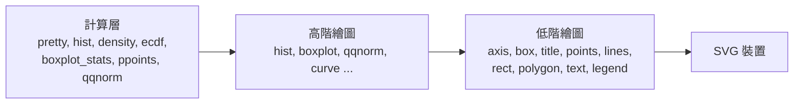

# rstatistics 繪圖規劃

狀態：規劃中，尚未實作（2026-11-06）。

目標：讓 rstatistics 支援 R 中適合機率統計的繪圖函數。數值要和 R 一致，外觀要像 R；用 rupy 寫成，所以在 CPython、rupy（Rust / wasm / 瀏覽器）上的輸出完全相同，而且不依賴任何套件。

## 一、函數範圍

| 優先 | R 函數 | 用途 |
| --- | --- | --- |
| 第一批 | `hist`、`plot(density(x))`、`boxplot`、`qqnorm` / `qqline`、`plot(ecdf(x))`、`curve` | 分佈形狀、常態性檢查、經驗分佈、理論密度 |
| 第一批 | `plot(x, y)`（`type = "p" / "l" / "b" / "h" / "s"`）、`barplot`、`abline`、`legend` | 基本圖與疊加 |
| 第二批 | `qqplot`、`stripchart`、`pairs`、`matplot`、`par(mfrow=)` | 比較與多變數 |
| 之後 | `plot(lm)` 診斷圖（`lm` 已在 rstatistics 0.3.0 完成）、`mosaicplot`、`pie` | 視需要 |

## 二、架構



### 1. 計算層（與 R 逐數字比對）

- `pretty()`：R 的刻度演算法，所有座標軸都用它。
- `hist()`：回傳 `breaks`、`counts`、`density`、`mids`。分組用 Sturges / Scott / FD，`right = TRUE` 與 `include.lowest` 的規則照 R。
- `density()`：頻寬用 `bw.nrd0` / `bw.nrd`，支援各種 kernel，`n = 512`。照 R 的作法先 binning 再做 FFT（`BinDist` + `fft`），數字才會和 R 一致。
- `boxplot_stats`（`coef = 1.5`，含離群值與 notch）、`ecdf`、`ppoints`、`qqnorm` 座標、`qqline` 的截距與斜率。

### 2. 繪圖層：R base graphics 模型，自己輸出 SVG

- 裝置預設 7×7 吋；邊界 `mar = c(5, 4, 4, 2) + 0.1`，標籤距離 `mgp = c(3, 1, 0)`。
- 座標軸範圍兩端各多留 4%（`xaxs = "r"`），刻度由 `pretty()` 決定。
- 外框、`pch`（預設空心圓）、`lty`、`lwd`、`col`、標題位置都照 R。
- 低階函數：`plot_new`、`plot_window`、`axis`、`box`、`title`、`mtext`、`points`、`lines`、`segments`、`rect`、`polygon`、`abline`、`text`、`legend`。
- 不建在 matplotlib 或 ruai.plot 上：那樣兩邊的圖會不同，外觀也不像 R，CPython 還要依賴 matplotlib。

## 三、API（受 rupy 語言限制）

rupy 的函數不能修改模組層級的變數，所以 R 的「目前裝置」改成一個明確的物件，和 `set_seed` 回傳 RNG 的模式相同：

```python
import rstatistics as r

g = r.graphics(width=7, height=7)    # 相當於 R 的 svg() 裝置
g.hist(x, main="Histogram of x")
g.lines(r.density(x))                 # 疊加
g.save("hist.svg")                    # 或 g.svg() 取得 SVG 字串

g = r.graphics(mfrow=(1, 2))
g.qqnorm(x)
g.qqline(x)
g.boxplot([a, b], names=["A", "B"])
```

wasm 後端不支援把函數當作值傳遞，所以 R 的 `curve(dnorm, -3, 3)` 不能照原樣做。第一版的做法：

- `g.curve("dnorm", -3, 3, mean=0, sd=1)`：用名稱指定分佈。
- 或由使用者算好 `xs`、`ys`，再呼叫 `g.lines(xs, ys)`。
- 替 wasm 後端加上「函數當值」是另一項獨立工作。

顯示：`g.show()` 在 CPython 寫出檔案或開啟瀏覽器；在 rupy playground，要讓 `host.mjs` 和 playground 認得 SVG 輸出並直接顯示。

## 四、驗證

- 數值：計算層和 R 比對，相對誤差在 1e-12 內或完全相同，沿用 `rstatistics/tests/run.py`（R 腳本與 R 輸出存在 repo 裡）。
- 版面：用 R 的 `svg()` 畫同一張圖，比對座標軸範圍、刻度位置、點與線在裝置上的座標。字型量測不同，所以不要求像素完全一致。
- 回歸測試：rstatistics 產生的 SVG 存成金標準，CPython、rupy（Rust）、wasm 三邊輸出必須完全相同（放在 `tests/corpus/rstatistics`）。
- 人工檢查：R 與 rstatistics 的圖並排輸出，確認一次外觀。

## 五、階段

| 階段 | 內容 | 完成條件 |
| --- | --- | --- |
| 1 | 計算層：`pretty`、`hist`、`density`、`ecdf`、`boxplot_stats`、`ppoints`、`qqnorm` | 與 R 數值比對全部通過 |
| 2 | SVG 引擎與低階函數 | 能畫出 R 風格的座標系與點線 |
| 3 | 第一批高階函數 | hist、density、boxplot、qq、ecdf、curve、barplot、plot |
| 4 | `mfrow`、`legend`、瀏覽器顯示、文件 | 發佈 rstatistics 0.2.0 |
| 5 | 第二批：`qqplot`、`pairs`、`stripchart`、`matplot` | 之後 |

每完成一個階段就 commit 一次。

## 六、待決定

1. 繪圖方式：自己做 R 風格的 SVG 引擎（建議），或建在 matplotlib 上。
2. API：採用 `g = r.graphics()` 物件的寫法。
3. `curve`：第一版用分佈名稱 `g.curve("dnorm", ...)`。
