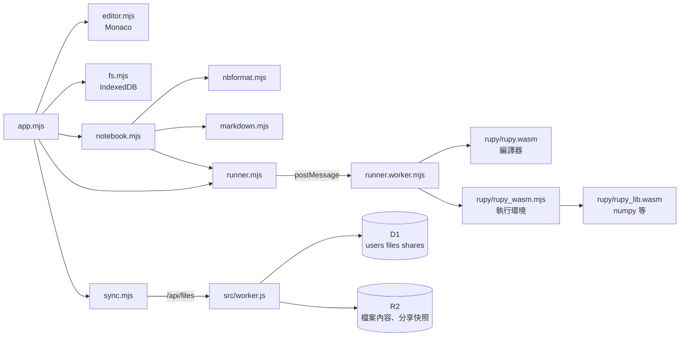

# rupy IDE

在瀏覽器裡寫、編譯、執行 rupy 的 IDE（VS Code + Colab 式），跑在 [rucloud](../../rucloud) 上。
程式在瀏覽器裡編譯（`rupy.wasm`，rupy 編譯器本身編成的 WebAssembly）並執行（`rupy_wasm.mjs`）；伺服器只負責帳號、檔案（D1 + R2）與分享連結。

```sh
sh ide/build.sh              # 建置 web/ 的 wasm（cargo + wasm32-unknown-unknown），複製到 ide/public/rupy/
sh ide/build.sh --skip-cargo # 直接複製 web/ 已有的 wasm
cp ide/.dev.vars.example ide/.dev.vars   # 把 AUTH_SECRET 換成隨機長字串（openssl rand -hex 32）
rucloud dev ide              # http://localhost:8787
node --test ide/test/*.test.mjs          # 筆記本邏輯 + API（API 測試會自己起一個 rucloud）
```

沒有 `.dev.vars`（`AUTH_SECRET`）時沒有帳號功能，IDE 仍可純本機使用。要用 AI 助手，在 `.dev.vars` 加上 `AI_BASE_URL`、`AI_MODEL`、`AI_API_KEY`（OpenAI 相容的 API，例如 MiniMax；見 `.dev.vars.example`）。

需要支援 WasmGC 與 wasm 例外處理的瀏覽器（Chrome 119+、Firefox 120+、Safari 18.2+）。

## 目前功能（M0–M6）

* Monaco 編輯器（從 jsdelivr 載入），Python 語法上色，深色模式跟著系統。
* 檔案存在瀏覽器的 IndexedDB；側欄可以新增、重新命名、刪除。第一次開會放入範例程式。
* 執行（Ctrl/⌘ + Enter）在 Web Worker 裡，輸出邊跑邊顯示；「停止」會結束 Worker，所以無窮迴圈也停得下來。
* 打字時另一個 Worker 會在背景編譯，把編譯錯誤標在那一行。
* 「標準輸入」分頁的文字給 `input()` 一行一行讀。
* **筆記本（`.ipynb`）**：程式格與文字格（Markdown，可寫 TeX `$…$`、`$$…$$`），輸出顯示在各格下方並存進檔案。
  * Shift + Enter 執行並到下一格（最後一格會新增一格），Ctrl/⌘ + Enter 只執行；「全部執行」跑完所有程式格。
  * **前綴重跑**：執行第 $k$ 格時，第 $1..k$ 個程式格接成一支程式重新編譯執行，所以後面的格子看得到前面的變數和函式。每格前面印一個標記 `\x1e<格號>\x1e`，用來把輸出分給各格；編譯錯誤的行號換算回各格。
  * 因為是一支程式，同一個變數在不同格子裡也不能換型別（`n = 10` 之後不能 `n = "x"`）。
  * 文字格點兩下編輯，離開或 Shift + Enter 就顯示排版結果。
* **帳號與雲端存檔**（右上角「登入」）：
  * 註冊或登入後，檔案先存在本機，約 1.5 秒後上傳；另一台電腦改過的檔案會在切回視窗、每分鐘或下次編輯時下載。
  * 第一次登入會問要不要把這台電腦上自己的檔案（未修改的範例除外）複製到帳號。
  * 兩邊都改過同一個檔案時，以伺服器的版本為準，本機的內容另存成 `名稱.conflict-<時間>.py`，不會遺失。
  * 登出會先同步，再刪掉這台電腦上該帳號的本機副本（檔案仍在伺服器）。
* **分享**：登入後檔案旁的 ⇪ 產生唯讀連結 `/s/<id>`（當下內容的快照，之後修改要再分享一次）。分享頁顯示程式或筆記本（含輸出、Markdown、TeX），「在 IDE 開啟副本」會把它複製到自己的工作區。帳號選單可以列出與取消自己的分享。
* **圖形（M5）**：程式印出的 SVG 文件（以 `<?xml` 或 `<svg` 開頭的一行，到 `</svg>` 為止）會顯示成圖，例如 rstatistics 的 `print(g.svg())`；同一支程式在 CPython 下印出的是同樣的 SVG 文字。筆記本把圖存成 nbformat 的 `display_data`（`image/svg+xml`），從 Jupyter 匯入的 PNG 圖也會顯示。圖用 `` 顯示，SVG 裡的程式不會執行。
* **讀寫檔案（M5）**：`open()` 讀的是工作區裡的檔案（`open("data.csv")`），寫出的檔案（`g.save("hist.svg")`、`open("out.txt", "w")`）在程式結束後存進工作區，狀態列會列出寫了哪些檔。`.svg` 檔開啟時顯示圖，右上角可以切換成原始碼。其他文字檔（`.txt`、`.csv`、`.json` …）用編輯器開啟。
* **AI 助手（M6）**：工具列「✦ AI」打開右側面板（要登入，伺服器要設定 AI）。可以問 rupy 的問題，或請它改目前的檔案；筆記本則是改目前這一格。編譯或執行出錯時，工具列出現「✦ AI 修正」，會把錯誤一起送過去。AI 給的程式先在背景編譯，編不過就自動把錯誤交回給它再改（最多兩次）；通過的標「✓ 編譯通過」。「看差異並套用」先顯示差異，套用後可以 Ctrl/⌘ + Z 復原。對話只存在分頁裡。詳見 [doc/ide-ai.md](../doc/ide-ai.md)。
* 側欄「匯入」可以匯入程式、筆記本與資料檔（`.py`、`.ipynb`、`.txt`、`.csv`、`.json`、`.svg` …）（Jupyter / Colab 的筆記本也行，只是多半用到 rupy 不支援的 Python）；工具列「下載」下載目前的檔案。

**多檔專案**：執行或檢查時，工作區裡所有檔案一起交給編譯器（`rupy.wasm` 的 `compile_project`），所以程式可以 `import geometry`、`from geometry import Point`（`geometry.py` 和主程式在同一個資料夾）。筆記本也一樣，它的程式當成和筆記本同一個資料夾的檔案。模組裡的錯誤標在模組那一行，主程式（或筆記本的第一個程式格）第一行會有一個警告指出是哪個檔案。被 import 的模組只能定義函式、類別和常數（rupy 的規則）。

## 結構



| 檔案 | 用途 |
|---|---|
| `wrangler.jsonc` | rucloud 設定：`public/` 靜態檔案，`/api/*` 交給 `src/worker.js` |
| `src/worker.js` | API：帳號（PBKDF2 + HMAC 簽章 cookie）、檔案、分享；`/s/<id>` 回傳分享頁 |
| `public/sync.mjs` | 本機與伺服器的同步（版本號、衝突時另存一份） |
| `public/share.html`、`public/share.mjs` | 唯讀分享頁 |
| `public/app.mjs` | 介面：檔案、編輯器、執行、輸出 |
| `public/runner.mjs`、`public/runner.worker.mjs` | 在 Web Worker 編譯（`compile_project`，傳入整個工作區）與執行，停止時結束 Worker |
| `public/ai.mjs` | AI 助手的面板：串流對話、抽出回覆裡的程式、編譯驗證與自動重試、套用 |
| `public/rich.mjs` | 從輸出裡切出 SVG 文件，顯示成 `` |
| `public/fs.mjs` | IndexedDB 檔案存取（每個帳號一個資料庫；記錄版本、是否改過、刪除標記） |
| `public/editor.mjs` | 載入 Monaco |
| `public/notebook.mjs` | 筆記本介面：每格一個 Monaco、輸出、新增/移動/刪除格子 |
| `public/nbformat.mjs` | 不碰 DOM 的部分：`.ipynb` 讀寫、前綴程式、輸出切分、錯誤行號換算 |
| `public/markdown.mjs` | 文字格：marked + DOMPurify + KaTeX（從 jsdelivr 載入） |
| `public/examples.mjs` | 範例程式（取自 `web/playground.mjs`）與範例筆記本 `intro.ipynb` |
| `test/api.test.mjs` | API 測試：帳號、檔案版本與衝突、帳號隔離、分享（需要 `rucloud`） |
| `test/project.test.mjs` | 多檔專案：import 模組、子資料夾、錯誤所在的檔案與行 |
| `test/ai.test.mjs` | AI 的 API（用假的 OpenAI 相容伺服器）：登入檢查、串流、送出的內容、額度、跨站；回覆的解析 |
| `test/rich.test.mjs` | 圖形輸出的切分、筆記本存圖、`open()` 讀寫工作區、rstatistics 在 wasm 上畫圖 |
| `test/nbformat.test.mjs` | `node --test ide/test/*.test.mjs`：用真的編譯器測筆記本（先跑 `ide/build.sh`） |

後續的里程碑見 [doc/ide-plan.md](../doc/ide-plan.md)。

## 伺服器的資料

| 位置 | 內容 |
|---|---|
| D1 `users` | email、PBKDF2 密碼雜湊與 salt |
| D1 `files` | 每個帳號的檔案：路徑、版本、大小、修改時間、R2 物件的 key |
| D1 `shares` | 分享連結：id、帳號、檔名、建立時間 |
| D1 `ai_usage` | 每個帳號每天用了幾次 AI（上限 `AI_DAILY_LIMIT`，預設 100） |
| R2 `u/<帳號>/<隨機>` | 檔案內容；每次寫入都是新物件 |
| R2 `s/<id>` | 分享的快照 |

上傳時用 `If-Match: <版本>` 說明這份內容是根據哪個版本改的（新檔案是 0）。內容先寫進新的 R2 物件，D1 只有在版本仍相同時才改指到它，所以兩個同時寫入只會有一個成功，另一個得到 409 並刪掉自己的物件。單檔上限 1 MB，每個帳號最多 1000 個檔案。

## 編譯器的介面

`rupy.wasm`（`examples/rupy_wasm.rs`）的 `compile_project(ptr, len)` 讀 JSON：

```json
{ "main": "main.py", "files": { "main.py": "import geometry\n…", "geometry.py": "…" } }
```

成功回傳 0，輸出是程式的 wasm；失敗回傳 1，輸出是 JSON `{"file", "line", "msg", "hint"}`（`line` 為 0 表示沒有行號，例如 wasm 後端不支援的功能）。Rust 這邊是 `rupy::wasm::compile_files`，模組從 `modules::Files`（磁碟或一組文字）讀取。

編譯好的程式用 `rupy_wasm.mjs` 的 `run(bytes, io)` 執行。`io.files` 是 `open()` 讀寫的檔案，可以是任何有 `get(path)` 與 `set(path, text)` 的物件（例如 `Map`）。IDE 傳入整個工作區；`node rupy_wasm.mjs` 則直接讀寫磁碟。寫出的內容在檔案關閉或程式結束時寫回 `io.files`，並呼叫 `io.onFile(path, text)` 通知。支援文字模式的 `r`、`w`、`a`，以及 `read`、`readline`、`readlines`、`write`、`writelines`、`for line in f` 和 `with open(...) as f`，和原生後端相同。
