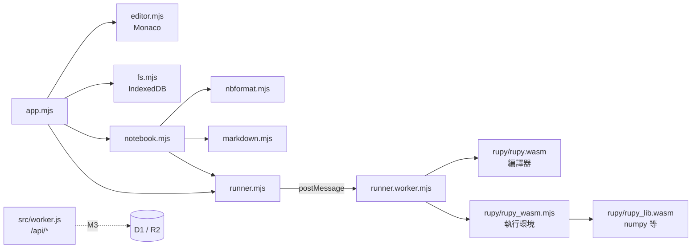

# rupy IDE

在瀏覽器裡寫、編譯、執行 rupy 的 IDE（VS Code + Colab 式），跑在 [rucloud](../../rucloud) 上。
程式在瀏覽器裡編譯（`rupy.wasm`，rupy 編譯器本身編成的 WebAssembly）並執行（`rupy_wasm.mjs`），伺服器只提供靜態檔案。

```sh
sh ide/build.sh              # 建置 web/ 的 wasm（cargo + wasm32-unknown-unknown），複製到 ide/public/rupy/
sh ide/build.sh --skip-cargo # 直接複製 web/ 已有的 wasm
rucloud dev ide              # http://localhost:8787
```

需要支援 WasmGC 與 wasm 例外處理的瀏覽器（Chrome 119+、Firefox 120+、Safari 18.2+）。

## 目前功能（M0 + M1 + M2）

* Monaco 編輯器（從 jsdelivr 載入），Python 語法上色，深色模式跟著系統。
* 檔案存在瀏覽器的 IndexedDB；側欄可以新增、重新命名、刪除。第一次開會放入範例程式。
* 執行（Ctrl/⌘ + Enter）在 Web Worker 裡，輸出邊跑邊顯示；「停止」會結束 Worker，所以無窮迴圈也停得下來。
* 打字時另一個 Worker 會在背景編譯，把編譯錯誤標在那一行。
* 「標準輸入」分頁的文字給 `input()` 一行一行讀。
* **筆記本（`.ipynb`）**：程式格與文字格（Markdown，可寫 TeX `$…$`、`$$…$$`），輸出顯示在各格下方並存進檔案。
  * Shift + Enter 執行並到下一格（最後一格會新增一格），Ctrl/⌘ + Enter 只執行；「全部執行」跑完所有程式格。
  * **前綴重跑**：執行第 $k$ 格時，第 $1..k$ 個程式格接成一支程式重新編譯執行，所以後面的格子看得到前面的變數和函式。每格前面印一個標記 `\x1e<格號>\x1e`，用來把輸出分給各格；編譯錯誤的行號換算回各格。
  * 因為是一支程式，同一個變數在不同格子裡也不能換型別（`n = 10` 之後不能 `n = "x"`）。
  * 文字格點兩下編輯，離開或 Shift + Enter 就顯示排版結果。
* 側欄「匯入」可以匯入 `.py` 與 `.ipynb`（Jupyter / Colab 的筆記本也行，只是多半用到 rupy 不支援的 Python）；工具列「下載」下載目前的檔案。

一次只編譯目前開啟的檔案；`import` 同專案的其他檔案要等 M4。

## 結構



| 檔案 | 用途 |
|---|---|
| `wrangler.jsonc` | rucloud 設定：`public/` 靜態檔案，`/api/*` 交給 `src/worker.js` |
| `src/worker.js` | API（目前只有 `/api/health`；M3 起帳號與雲端存檔） |
| `public/app.mjs` | 介面：檔案、編輯器、執行、輸出 |
| `public/runner.mjs`、`public/runner.worker.mjs` | 在 Web Worker 編譯與執行，停止時結束 Worker |
| `public/fs.mjs` | IndexedDB 檔案存取 |
| `public/editor.mjs` | 載入 Monaco |
| `public/notebook.mjs` | 筆記本介面：每格一個 Monaco、輸出、新增/移動/刪除格子 |
| `public/nbformat.mjs` | 不碰 DOM 的部分：`.ipynb` 讀寫、前綴程式、輸出切分、錯誤行號換算 |
| `public/markdown.mjs` | 文字格：marked + DOMPurify + KaTeX（從 jsdelivr 載入） |
| `public/examples.mjs` | 範例程式（取自 `web/playground.mjs`）與範例筆記本 `intro.ipynb` |
| `test/nbformat.test.mjs` | `node --test ide/test/*.test.mjs`：用真的編譯器測筆記本（先跑 `ide/build.sh`） |

後續的里程碑見 [doc/ide-plan.md](../doc/ide-plan.md)。
